# Wayfinder: OpenStreetMap analytics

How many roads does a country have? How many lakes, schools or bus stops, and which region has the most? Wayfinder answers questions like these from [OpenStreetMap](https://www.openstreetmap.org) data, on your own machine. Pick a country, and it downloads the OSM extract, builds a local database and map, and opens it in your browser. Nothing is hosted for you, and no account or API key is needed.

- **Count anything mapped in OSM.** Get totals for any tag or value, such as `highway`, `natural=water`, `waterway`, `building` or `amenity=school`.
- **Compare regions.** See each region's count, share of the country and density per km².
- **Break down the numbers.** See how a tag splits across its values, such as `residential`, `track` and `service` roads, and combine tags to narrow a question.
- **Check how current the data is.** See when objects were last edited, and which areas have gone stale.
- **See where the numbers come from.** Plot matches on the map, inspect every tag on an object, search near any point, and export tables as CSV.

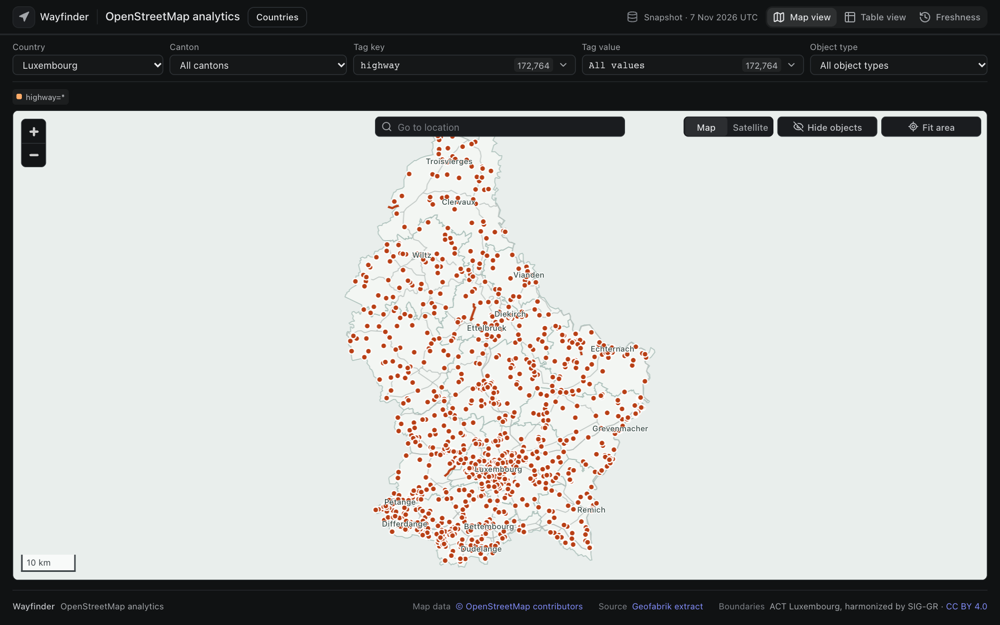

## Install

You need macOS or Linux, [Node.js](https://nodejs.org) 22.13 or newer, Python 3.10 or newer, and [tippecanoe](https://github.com/felt/tippecanoe). On macOS, install tippecanoe with `brew install tippecanoe`. On Linux, build it from source.

```sh
git clone https://github.com/raajahuja/OSMAnalytics.git
cd OSMAnalytics
npm install
npm run setup
npm run dev
```

Open **http://localhost:5173**, select **Countries**, and download and build a country. Geofabrik's country and region extracts are all available. Regions are found automatically from the OSM admin boundaries.

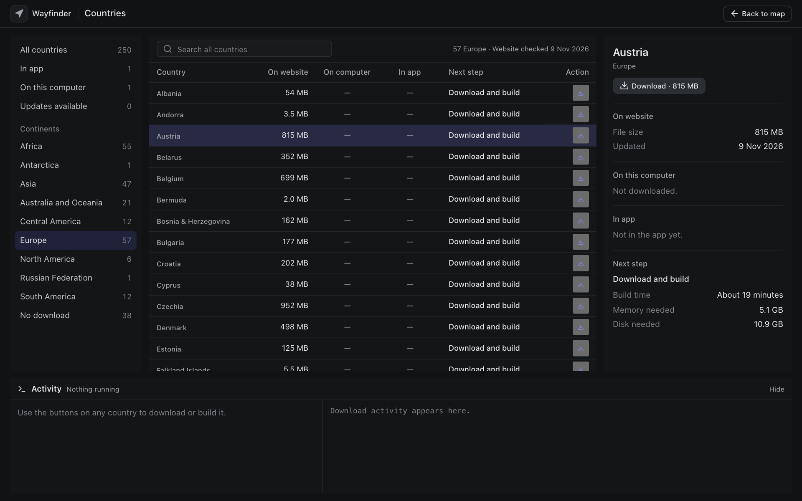

## What your machine needs

Building needs more memory and disk than the download itself. The Countries page estimates memory, disk and time before you start, and tells you if a country won't fit.

| Country | Download | Built size | Notes |
|---|---|---|---|
| Luxembourg | 48 MB | 384 MB | About 100 seconds and 800 MB of memory |
| Austria | 815 MB | 5.9 GB | Built on a laptop with 24 GB of memory |

The build holds data in memory, so very large countries need a lot of it, and the full planet isn't supported. See [AUDIT.md](AUDIT.md) for what that would take.

## Using it

The screenshots below use Luxembourg.

### Filter by tag

Choose any tag key and value from the filters above the map. Each one shows how many objects it matches. Dense views show up to 1,200 matches, and zooming in loads the matches in the new view.

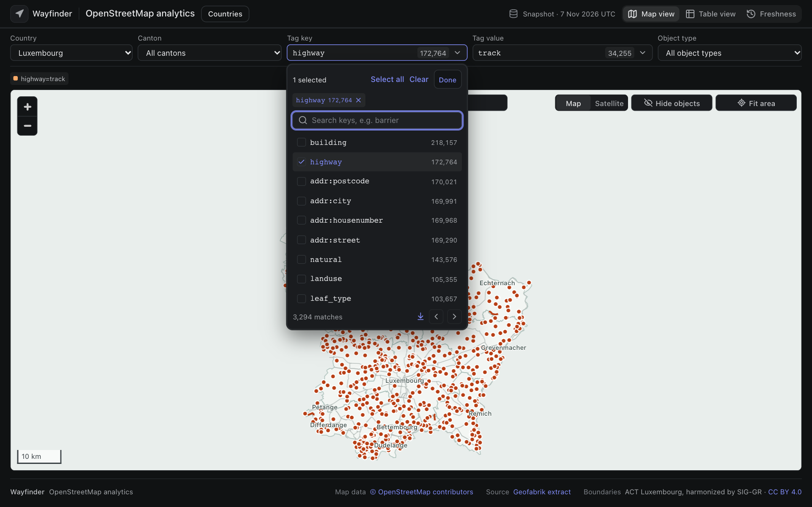

### Combine tags

Select several keys and values. Values for the same key are alternatives. **Match any key** combines keys, and **Match all keys** requires every selected key.

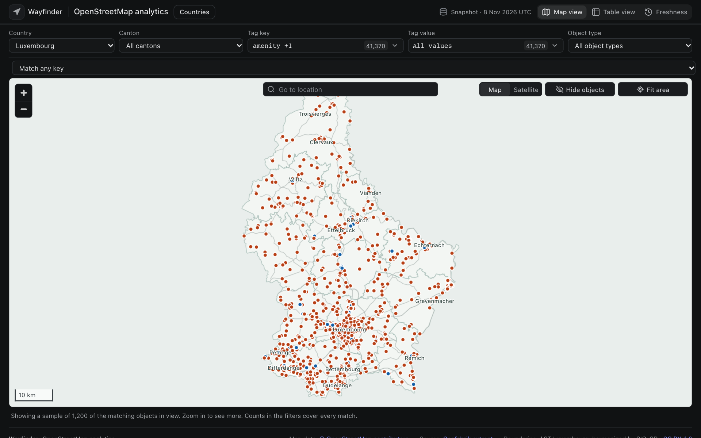

### Focus on a region

Selecting a region draws its boundary, fits the map, and limits the filter options to what's available there.

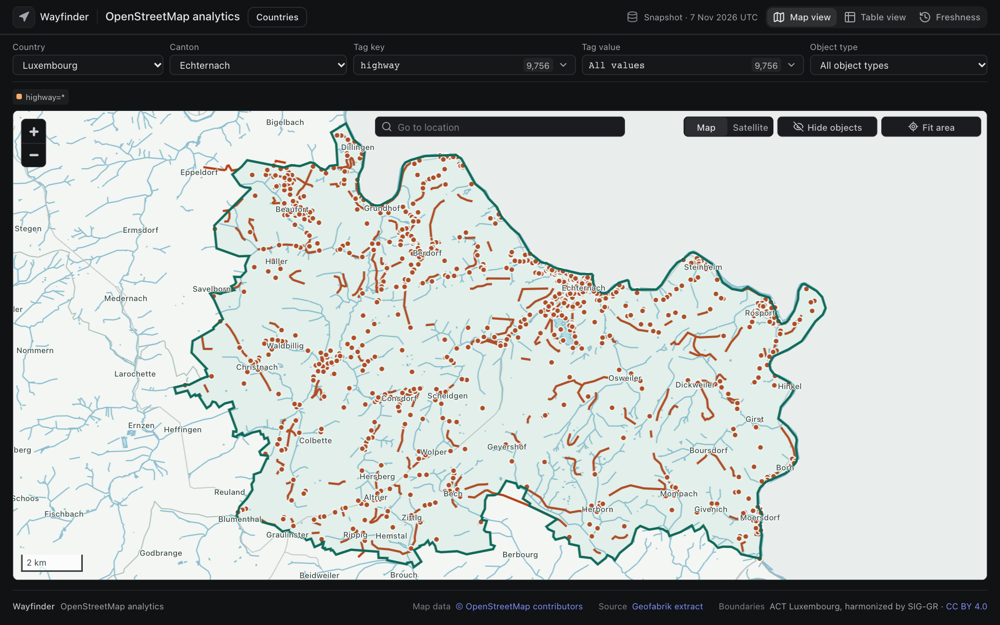

### Inspect an object

Click a highlighted point, line or area to see all its tags, its geometry, and when it was last edited, and to open the original on OpenStreetMap.

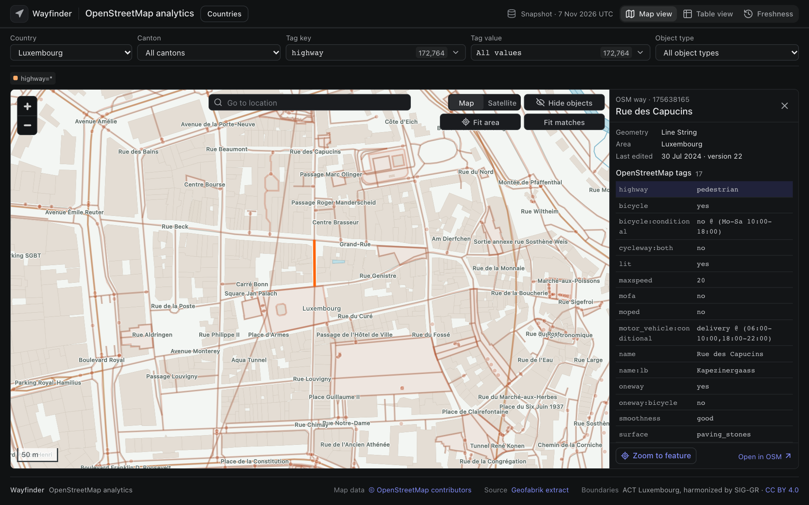

### Go to a place

Use **Go to location** to find a place in the data, or enter a latitude and longitude.

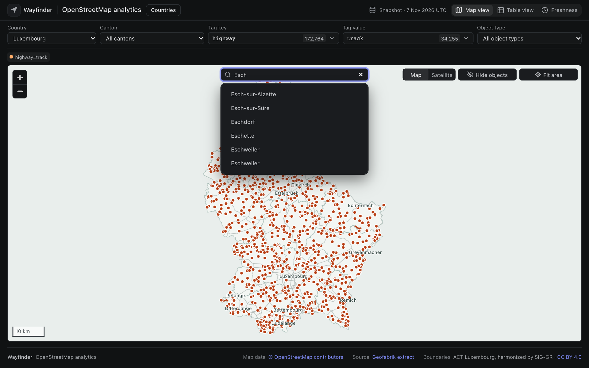

### Find what's nearby

Right-click the map, or long-press on a touch screen, and choose **Query nearby features** to list every indexed object within 25 m to 2 km of a point.

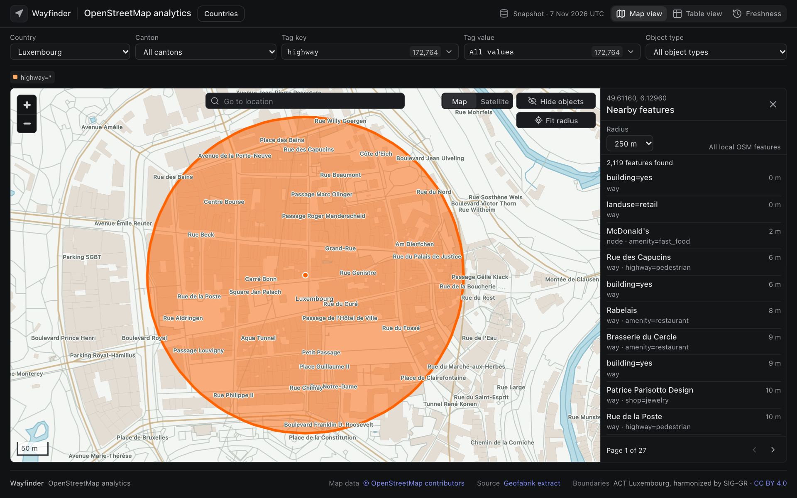

### See the numbers in a table

**Table view** uses the same filters, and shows the value distribution and every exact value. Select a value in the chart or table to update the filters, or export the table as CSV.

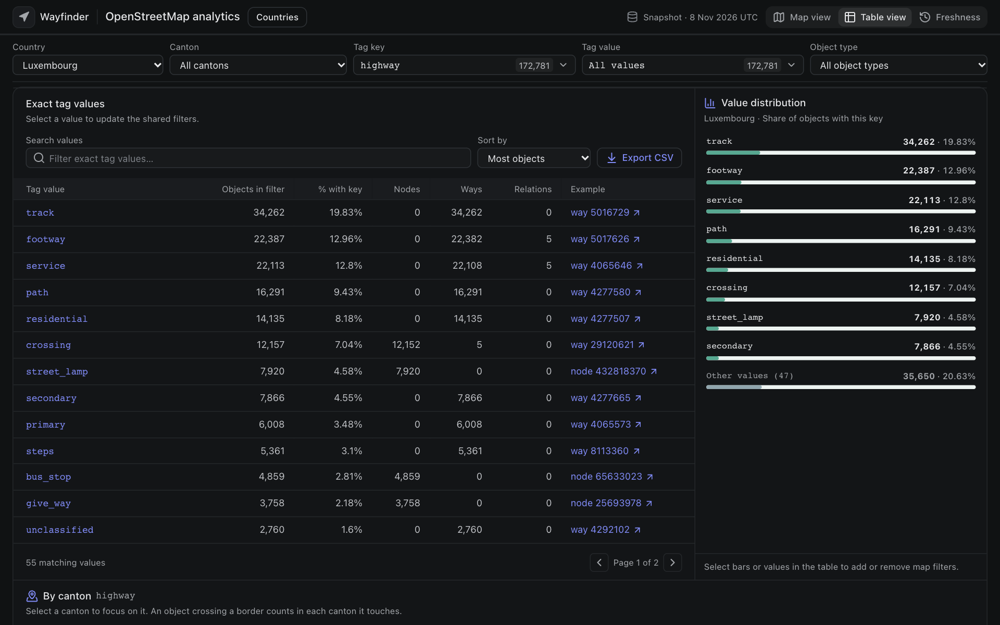

### Compare regions

Further down **Table view**, every region is compared for the selected key. Select a region to focus on it.

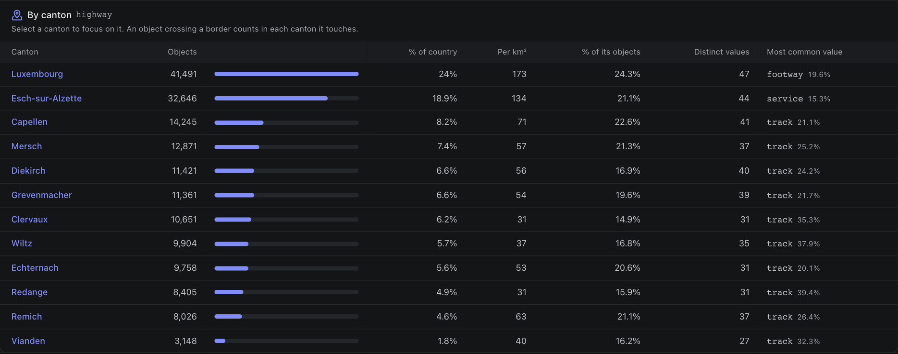

### Check how fresh the data is

**Freshness** shows how recently the objects in the current filters were edited, using each object's version and last-edit time from the extract. It maps stale areas and lists the most edited and longest untouched objects. The date is measured from the snapshot. A way's date changes when its tags or node list change, not when its nodes move.

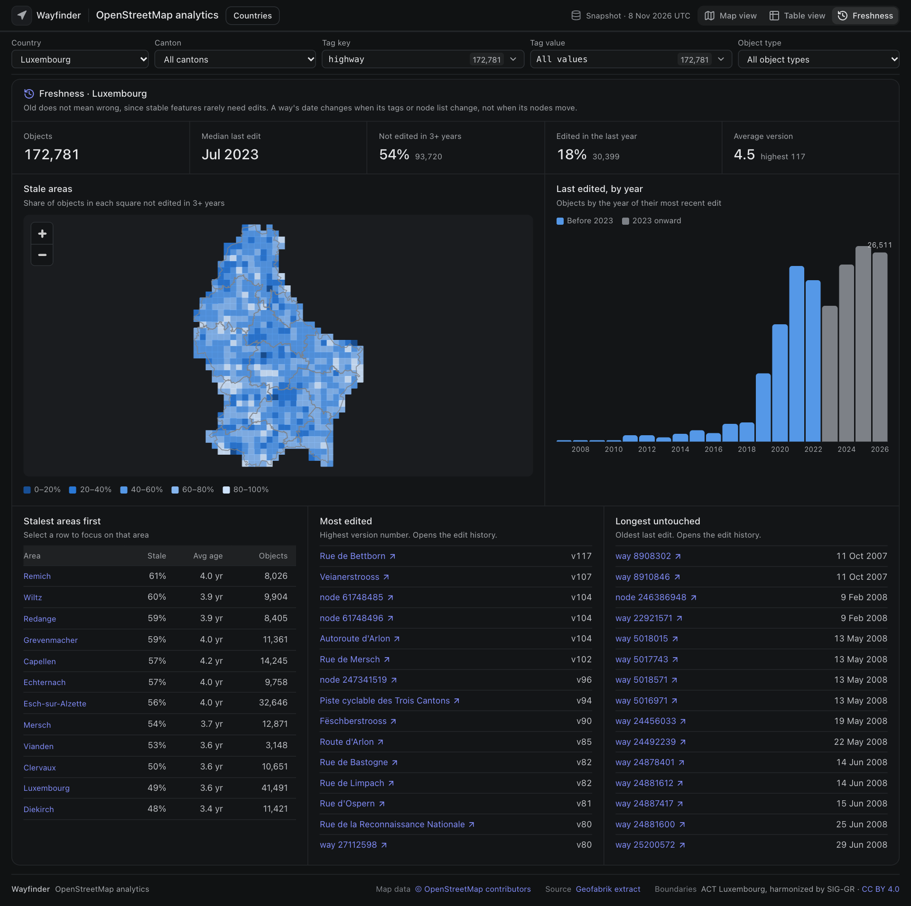

### Use satellite imagery

**Satellite** imagery is available for Luxembourg only, from the [Geoportail 2025 aerial imagery](https://data.public.lu/en/datasets/orthophoto-officielle-du-grand-duche-de-luxembourg-edition-ete-2025/).

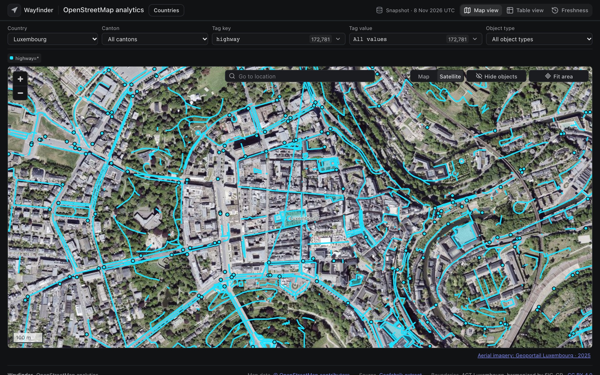

## Building from the command line

Luxembourg has hand-checked settings and its official canton boundaries. To download and build it:

```sh
npm run analytics:setup
```

Run `npm run analytics:prepare` to rebuild from the files already downloaded.

To give another country hand-checked settings, copy `code/pipeline/countries/LU.json` to `XX.json`, where `XX` is a two-letter code, and update it. Put the extract and a GeoJSON file of regions in `input/`, with `code` and `name` properties on each region, then run:

```sh
.venv/bin/python code/pipeline/prepare-analytics.py --country XX
```

`expectedRegions` and `crs` are optional. Without `crs`, lengths and areas use an equal-area projection centred on the country.

## Project layout

| Folder | Contents | Safe to delete? |
|---|---|---|
| `input/` | Downloaded OSM extracts and boundaries | Yes, but they must be downloaded again |
| `code/` | `server/`, `pipeline/`, `web/` and `tests/` | No |
| `output/` | Generated databases, map tiles, image cache, web build, reports | Yes, it can be rebuilt |

Each country is two files in `output/analytics`: `XX.sqlite` for queries and `XX.pmtiles` for the base map. Set `WAYFINDER_INPUT` or `WAYFINDER_OUTPUT` to use other folders.

## Serving it to others

For a production build, run `npm run build` and `npm start`. The app binds to `127.0.0.1:5173` by default. To put it on a public site, set `WAYFINDER_PUBLIC=1`. Nobody can then start a download or build, the Countries page is removed, and each client address is rate limited.

| Setting | Default | Purpose |
|---|---|---|
| `NODE_ENV` | none | Set to `production` to serve the built app and write JSON logs |
| `HOST` | `127.0.0.1` | Use `0.0.0.0` in a container |
| `PORT` | `5173` | Listening port |
| `WAYFINDER_PUBLIC` | off | `1` for public mode |
| `WAYFINDER_TRUSTED_PROXIES` | `0` | How many proxies add to `X-Forwarded-For`. Leave at 0 if none, or clients can forge their address |
| `WAYFINDER_QUERY_TIMEOUT_MS` | `15000` | Longest a query can run before it returns 504 |
| `WAYFINDER_QUEUE_LIMIT` | `100` | Waiting queries before new ones get 503 |
| `WAYFINDER_RATE_PER_SECOND`, `WAYFINDER_RATE_BURST` | `5`, `60` | Allowance for each client address |

`/api/health` returns 200 while databases are present and workers are running. Serve `/tiles/` from a store that supports byte ranges if you put it behind a CDN. API URLs carry the dataset version, so a new build replaces cached responses without any purge.

A multi-key filter in Freshness is computed live and can reach the query limit on large countries. Freshness for one key, one key and value, or all objects is stored at build time when it covers at least 50,000 objects.

## Tests

```sh
npm test
```

This runs the unit, smoke, integration and regression tests. Most use a small synthetic extract built by `code/tests/fixtures/build_fixture.py`, and those needing real data skip themselves unless Luxembourg is built. Each tier has its own command, such as `npm run test:unit`.

`npm run screenshots` walks through every feature in Chrome on real Luxembourg data, and retakes the images in this README. `npm run test:visual` compares screenshots, and its baselines were taken on macOS. Run `npm run test:perf` for latency budgets on real data. After an intended change, refresh expected results with `UPDATE_GOLDEN=1 npm run test:regression` or `npx playwright test --update-snapshots`.

Known bugs and the plan for planet-scale builds are in [AUDIT.md](AUDIT.md).

## License and data

The code is under the [MIT License](LICENSE).

The data is not. OpenStreetMap data is © OpenStreetMap contributors, under the [Open Database License](https://www.openstreetmap.org/copyright). Databases and tiles you build are derived from it and stay under the ODbL if you share them, and anything you publish from them must credit OpenStreetMap. [LICENSING.md](LICENSING.md) has more detail for public sites.

Extracts come from [Geofabrik](https://download.geofabrik.de). The Luxembourg [canton boundaries](https://data.public.lu/en/datasets/cantons-in-luxembourg-2026/) are from ACT Luxembourg, harmonized by SIG-GR, under CC BY 4.0.
